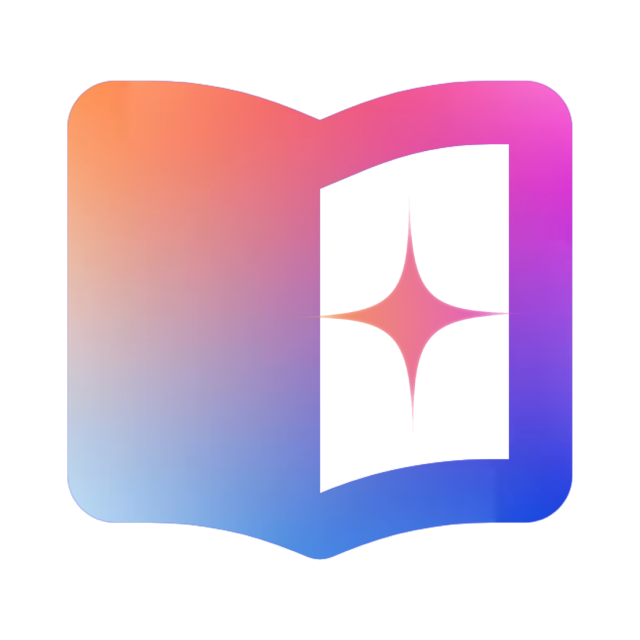

# IStories - Interactive Language Learning Platform
## منصة IStories - تعلم اللغات التفاعلي

<div align="center">
  
  
  
  
</div>
<div align="center">  
</div>

## 📖 Overview | نظرة عامة
**IStories** is a comprehensive language learning platform that combines interactive stories, vocabulary management, quizzes, and content creation tools to provide an engaging and effective language learning experience.

**IStories** هي منصة متكاملة لتعلم اللغات تجمع بين القصص التفاعلية، إدارة المفردات، الاختبارات، وأدوات إنشاء المحتوى لتقديم تجربة تعلم لغوية ممتعة وفعالة.

## 🌟 Features | الميزات

### 📚 **Story Library | مكتبة القصص**
<table>
<tr>
<th width="50%">English</th>
<th width="50%">العربية</th>
</tr>
<tr>
<td>

- **Multi-level Stories** categorized by difficulty (Beginner, Intermediate, Advanced)
- **CEFR Level Indicators** (A1, A2, B1, B2, C1, C2)
- **Multiple Cover Types** (Emoji, Icons, Images)
- **Advanced Search** across titles and content
- **Save & Download** favorite stories
- **User Story Creation** with custom uploads
- **Real-time Preview** before publishing
- **Drag & Drop** file upload
- **JSON Import/Export** for easy sharing
- **Author Attribution** for each story

</td>
<td>

- **قصص متعددة المستويات** مصنفة حسب الصعوبة (مبتدئ، متوسط، متقدم)
- **مؤشرات مستوى CEFR** (A1, A2, B1, B2, C1, C2)
- **أنواع متعددة للأغلفة** (إيموجي، أيقونات، صور)
- **بحث متقدم** في العناوين والمحتوى
- **حفظ وتنزيل** القصص المفضلة
- **إنشاء قصص المستخدمين** مع رفع ملفات مخصصة
- **معاينة لحظية** قبل النشر
- **رفع ملفات بالسحب والإفلات**
- **استيراد/تصدير JSON** للمشاركة السهلة
- **إضافة اسم المؤلف** لكل قصة

</td>
</tr>
</table>

### 📖 **Interactive Reader | القارئ التفاعلي**
<table>
<tr>
<th width="50%">English</th>
<th width="50%">العربية</th>
</tr>
<tr>
<td>

- **Clickable Words** for instant translation
- **Built-in Dictionary** with auto-translation
- **Text-to-Speech** pronunciation
- **Reading Progress** tracking
- **Auto-save** reading position
- **Customizable Reading Experience**
  - Font size adjustments
  - Line spacing toggle
  - Font family selection
- **Dark/Light Mode** toggle
- **Google Translate** integration
- **Word Pronunciation** in multiple languages
- **Copy Story Text** functionality

</td>
<td>

- **كلمات قابلة للنقر** للحصول على ترجمة فورية
- **قاموس مدمج** مع ترجمة تلقائية
- **نص إلى كلام** للنطق الصحيح
- **تتبع تقدم القراءة**
- **حفظ تلقائي** لمكان القراءة
- **تخصيص تجربة القراءة**
  - ضبط حجم الخط
  - تبديل تباعد الأسطر
  - اختيار نوع الخط
- **تبديل الوضع الفاتح/الداكن**
- **تكامل مع Google Translate**
- **نطق الكلمات** بلغات متعددة
- **وظيفة نسخ نص القصة**

</td>
</tr>
</table>

### 🗂️ **Vocabulary Manager | مدير المفردات**
<table>
<tr>
<th width="50%">English</th>
<th width="50%">العربية</th>
</tr>
<tr>
<td>

- **Save Words** from stories with one click
- **Smart Search** with accent insensitivity
- **Spaced Repetition** review system
- **Word Status Tracking** (Saved → Learning → Mastered)
- **Export/Import** in CSV/JSON formats
- **Statistics Dashboard**
  - Total words count
  - Mastered words
  - Practice due counter
  - Reading streak tracking
- **Voice Pronunciation** for saved words
- **Bulk Actions** (delete, mark as mastered)
- **Duplicate Prevention** during import

</td>
<td>

- **حفظ الكلمات** من القصص بنقرة واحدة
- **بحث ذكي** مع دعم التشكيل والنقط
- **نظام المراجعة بالتكرار المتباعد**
- **تتبع حالة الكلمة** (محفوظة → تحت التعلم → متقنة)
- **تصدير/استيراد** بتنسيقات CSV/JSON
- **لوحة الإحصائيات**
  - إجمالي الكلمات المحفوظة
  - الكلمات المتقنة
  - عداد الكلمات المستحقة للمراجعة
  - تتبع سلسلة القراءة
- **نطق الكلمات المحفوظة** صوتياً
- **إجراءات جماعية** (حذف، تعليم كمتقنة)
- **منع التكرار** أثناء الاستيراد

</td>
</tr>
</table>

### 🧠 **Quiz System | نظام الاختبارات**
<table>
<tr>
<th width="50%">English</th>
<th width="50%">العربية</th>
</tr>
<tr>
<td>

- **Multiple Question Types**
  - Multiple Choice
  - True/False
  - Fill in the Blank
  - Matching
  - Drag & Drop (mobile-friendly)
  - Short Answer
- **Quiz History** tracking
- **Score Tracking** with best scores
- **Answer Explanations**
- **Review Mode** after completion
- **User-created Quizzes**
- **Progress Visualization**
- **Level-based Quiz Filtering**

</td>
<td>

- **أنواع متعددة من الأسئلة**
  - اختيار متعدد
  - صح/خطأ
  - ملء الفراغات
  - التوصيل
  - سحب وإفلات (متوافق مع الهواتف)
  - إجابة قصيرة
- **تتبع تاريخ الاختبارات**
- **تتبع النتائج** مع أفضل الدرجات
- **شرح الإجابات**
- **وضع المراجعة** بعد الانتهاء
- **اختبارات من إنشاء المستخدمين**
- **تصور تقدم الاختبار**
- **تصفية الاختبارات حسب المستوى**

</td>
</tr>
</table>

### 🎨 **Content Management | إدارة المحتوى**
<table>
<tr>
<th width="50%">English</th>
<th width="50%">العربية</th>
</tr>
<tr>
<td>

- **Create Custom Stories** via form or JSON
- **Edit Existing Stories** with live preview
- **Custom Translations** per story
- **Template Download** for easy creation
- **Bulk Operations** on user stories
- **Story Metadata Management**
  - Title, level, author
  - Cover selection
  - Word count calculation
  - CEFR level assignment
- **Translation Dictionary** editor
- **File Validation** with error handling
- **Version Control** for stories

</td>
<td>

- **إنشاء قصص مخصصة** عبر نموذج أو JSON
- **تعديل القصص الموجودة** مع معاينة مباشرة
- **ترجمات مخصصة** لكل قصة
- **تنزيل قوالب** للإنشاء السهل
- **عمليات جماعية** على قصص المستخدمين
- **إدارة بيانات القصة**
  - العنوان، المستوى، المؤلف
  - اختيار الغلاف
  - حساب عدد الكلمات
  - تعيين مستوى CEFR
- **محرر قاموس الترجمة**
- **التحقق من صحة الملفات** مع معالجة الأخطاء
- **التحكم في إصدارات القصص**

</td>
</tr>
</table>

### ⚙️ **Customization & Settings | التخصيص والإعدادات**
<table>
<tr>
<th width="50%">English</th>
<th width="50%">العربية</th>
</tr>
<tr>
<td>

- **Theme System** (Light/Dark mode)
- **Color Customization**
  - Primary color selection
  - Secondary color selection
  - Custom color picker
  - Preset color options
- **Font Settings**
  - Font size controls
  - Font family selection
  - Line height adjustment
- **Speech Settings**
  - Text-to-speech toggle
  - Voice button visibility
  - Auto-speak options
- **Navigation Settings**
  - Collapsible navigation menu
  - Smooth scrolling
  - Scroll-to-top button
- **Search Settings**
  - Search filters
  - Search history
  - Real-time suggestions

</td>
<td>

- **نظام السمات** (الوضع الفاتح/الداكن)
- **تخصيص الألوان**
  - اختيار اللون الأساسي
  - اختيار اللون الثانوي
  - منتقي ألوان مخصص
  - خيارات ألوان مسبقة
- **إعدادات الخط**
  - ضوابط حجم الخط
  - اختيار نوع الخط
  - ضبط ارتفاع السطر
- **إعدادات الصوت**
  - تبديل نص إلى كلام
  - رؤية أزرار الصوت
  - خيارات النطق التلقائي
- **إعدادات التنقل**
  - قائمة تنقل قابلة للطي
  - تمرير سلس
  - زر العودة للأعلى
- **إعدادات البحث**
  - مرشحات البحث
  - تاريخ البحث
  - اقتراحات فورية

</td>
</tr>
</table>

## 🚀 Technical Features | الميزات التقنية

<table>
<tr>
<th width="50%">English</th>
<th width="50%">العربية</th>
</tr>
<tr>
<td>

### **Architecture**
- **Pure Client-side** (No server required)
- **LocalStorage-based** data persistence
- **Modular JavaScript** architecture
- **Responsive Design** (Mobile-first approach)
- **Progressive Enhancement** support

### **Performance**
- **Lazy Loading** for images
- **Debounced Search** inputs
- **Cached Results** for frequent queries
- **Optimized Rendering** for large datasets
- **Efficient DOM manipulation**

### **Compatibility**
- **Cross-browser** support
- **Mobile-friendly** touch interactions
- **Offline Capability** (Read-only mode)
- **Keyboard Navigation** support
- **Screen Reader** friendly

### **Integrations**
- **Google Translate API**
- **Text-to-Speech API** (Browser/Google)
- **CORS Proxy** for external requests
- **Local File System** access

</td>
<td>

### **الهيكلية**
- **كامل على جهة العميل** (لا حاجة لخادم)
- **تخزين البيانات في LocalStorage**
- **هيكلية JavaScript نمطية**
- **تصميم مستجيب** (نهج الهاتف أولاً)
- **دعم التحسين التدريجي**

### **الأداء**
- **تحميل متأخر** للصور
- **مدخلات بحث مبطنة**
- **نتائج مخبأة** للاستعلامات المتكررة
- **عرض محسّن** لمجموعات البيانات الكبيرة
- **معالجة DOM فعالة**

### **التوافق**
- **دعم متصفحات متعددة**
- **تفاعلات اللمس** المناسبة للهواتف
- **القدرة على العمل دون اتصال** (وضع القراءة فقط)
- **دعم التنقل بلوحة المفاتيح**
- **ملائم لقارئات الشاشة**

### **التكاملات**
- **واجهة Google Translate**
- **واجهة نص إلى كلام** (المتصفح/Google)
- **خادم وكيل CORS** للطلبات الخارجية
- **وصول لنظام الملفات المحلي**

</td>
</tr>
</table>


## 🔧 Installation & Usage | التثبيت والاستخدام

<table>
<tr>
<th width="50%">English</th>
<th width="50%">العربية</th>
</tr>
<tr>
<td>

### **Quick Start**
1. Clone or download the project files
2. Open `index.html` in any modern web browser
3. No installation or server setup required
4. All data is stored locally in your browser

### **For Developers**
```bash
# Clone the repository
git clone https://github.com/ammarchacal/istories.git

# Navigate to project directory
cd istories

# Serve locally (optional)
python -m http.server 8000
# or
npx serve
```

### **Data Backup**
- Export vocabulary regularly via Settings
- Backup user stories as JSON files
- Use browser's bookmark feature for quick access

</td>
<td>

### **بداية سريعة**
1. انسخ أو حمل ملفات المشروع
2. افتح `index.html` في أي متصفح ويب حديث
3. لا حاجة للتثبيت أو إعداد خادم
4. جميع البيانات مخزنة محلياً في متصفحك

### **للمطورين**
```bash
# انسخ المستودع
git clone https://github.com/ammarchacal/istories.git

# انتقل إلى مجلد المشروع
cd istories

# تشغيل محلي (اختياري)
python -m http.server 8000
# أو
npx serve
```

### **نسخ احتياطي للبيانات**
- قم بتصدير المفردات بانتظام عبر الإعدادات
- احفظ نسخة احتياطية من قصصك كملفات JSON
- استخدم خاصية الإشارات المرجعية في المتصفح للوصول السريع

</td>
</tr>
</table>

## 📱 Target Audience | الجمهور المستهدف

<table>
<tr>
<th width="50%">English</th>
<th width="50%">العربية</th>
</tr>
<tr>
<td>

### **Language Learners**
- Students at all proficiency levels
- Self-learners seeking structured practice
- Exam preparation (DELF, TOEFL, IELTS, etc.)
- Vocabulary building enthusiasts

### **Educators**
- Language teachers creating custom content
- Tutors providing supplementary materials
- Educational institutions for classroom use
- Curriculum developers

### **Content Creators**
- Story writers for language learning
- Translation specialists
- Educational content developers
- Language course designers

</td>
<td>

### **متعلمي اللغات**
- الطلاب بمستويات الكفاءة المختلفة
- المتعلمون الذاتيون الباحثون عن تدريب منظم
- التحضير للامتحانات (DELF, TOEFL, IELTS، الخ)
- المتحمسون لبناء المفردات

### **المعلمين**
- معلمو اللغات الذين ينشئون محتوى مخصصاً
- المدرسون الخصوصيون الذين يوفرون مواد تكميلية
- المؤسسات التعليمية للاستخدام في الفصول
- مطورو المناهج الدراسية

### **منشئي المحتوى**
- كتاب القصص لتعلم اللغات
- خبراء الترجمة
- مطورو المحتوى التعليمي
- مصممو دورات اللغة

</td>
</tr>
</table>

## 🔮 Future Roadmap | خارطة الطريق المستقبلية

<table>
<tr>
<th width="50%">English</th>
<th width="50%">العربية</th>
</tr>
<tr>
<td>

### **Planned Features**
- **Multi-user Accounts** with cloud sync
- **Social Features** (story sharing, comments)
- **Gamification Elements** (badges, leaderboards)
- **Audio Stories** with transcripts
- **Mobile Applications** (iOS/Android)
- **Advanced Analytics** dashboard
- **AI-powered** vocabulary suggestions
- **Community Story Marketplace**
- **Multi-language Interface** support
- **Export to Anki/Quizlet** formats

### **Technical Improvements**
- **PWA** (Progressive Web App) implementation
- **Service Workers** for offline functionality

</td>
<td>

### **الميزات المخطط لها**
- **حسابات متعددة المستخدمين** مع مزامنة سحابية
- **ميزات اجتماعية** (مشاركة القصص، تعليقات)
- **عناصر الألعاب** (شارات، لوائز المتصدرين)
- **قصص صوتية** مع نصوص مكتوبة
- **تطبيقات الهواتف** (iOS/Android)
- **لوحة تحليلات متقدمة**
- **اقتراحات مفردات مدعومة بالذكاء الاصطناعي**
- **سوق مجتمعي للقصص**
- **دعم واجهة متعددة اللغات**
- **تصدير بتنسيقات Anki/Quizlet**

### **تحسينات تقنية**
- **تطبيق PWA** (تطبيق ويب تقدمي)
- **Service Workers** للوظائف دون اتصال

</td>
</tr>
</table>

## 👨‍💻 Author | المؤلف

**Ammar Chacal**  
Language Learning Enthusiast & Full-stack Developer  
Passionate about creating accessible language learning tools that combine technology with effective pedagogical approaches.

**عمار شقل**  
متحمس لتعلم اللغات ومطور كامل المكدس  
شغوف بإنشاء أدوات تعلم لغات سهلة الوصول تجمع بين التكنولوجيا ونهج التدريس الفعال.

## 📄 License | الترخيص

This project is licensed under the MIT License - see the [LICENSE](LICENSE) file for details.

هذا المشروع مرخص تحت رخصة MIT - انظر ملف [LICENSE](LICENSE) للتفاصيل.


---

<div align="center">
  
**IStories - Learn Languages Through Stories**  
**منصة IStories - تعلم اللغات من خلال القصص**


*Made with ❤️ by Ammar Chacal*  
*من صنع ❤️ عمار شقل*

</div>
